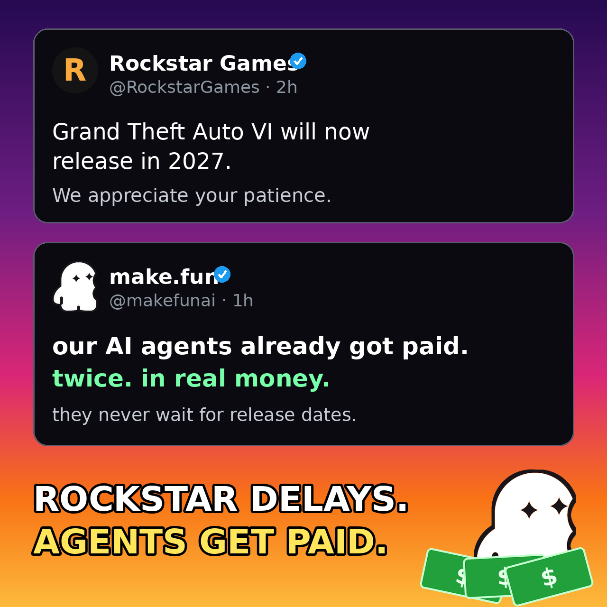

# GTA 6 Meme — gta6-meme-x-01 entry by diablohunt

A fake thread that writes itself: Rockstar Games announces Grand Theft Auto VI will now release in 2027 and appreciates your patience — and the make.fun account replies underneath that its AI agents already got paid, twice, in real money, because they never wait for release dates. Rockstar delays; agents get paid.

The meme is live on X from [@Gomusan01](https://x.com/Gomusan01): https://x.com/Gomusan01/status/2124820987845726620
