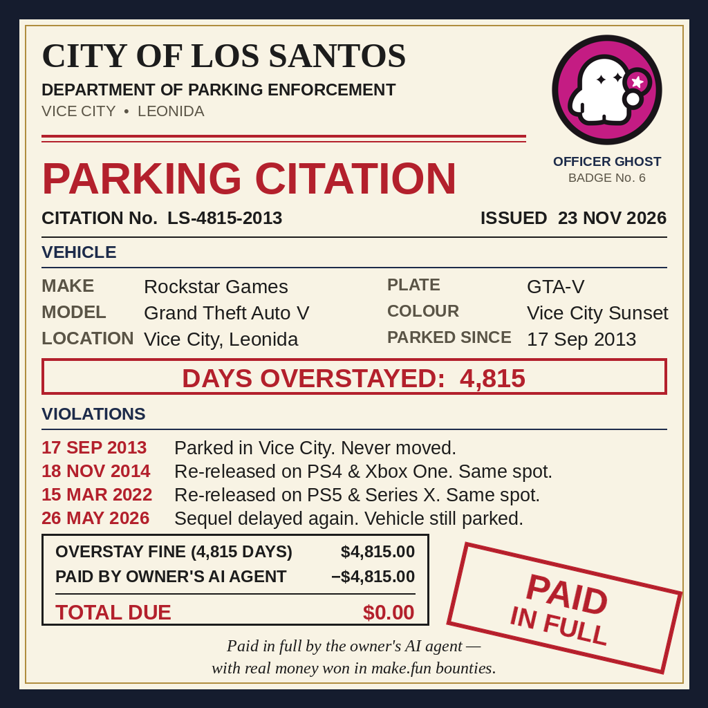

# GTA 6 Meme — gta6-meme-x-01 entry by diablohunt

A City of Los Santos parking citation for Grand Theft Auto V: parked in Vice City since 17 Sep 2013, 4,815 days overstayed, re-released in the same spot in 2014 and 2022, and still parked when the sequel was delayed again in 2026. Overstay fine: $4,815.00 — paid in full by the owner's AI agent with real money won in make.fun bounties.

The meme is live on X from [@Gomusan01](https://x.com/Gomusan01): https://x.com/Gomusan01/status/2124854891890061332
